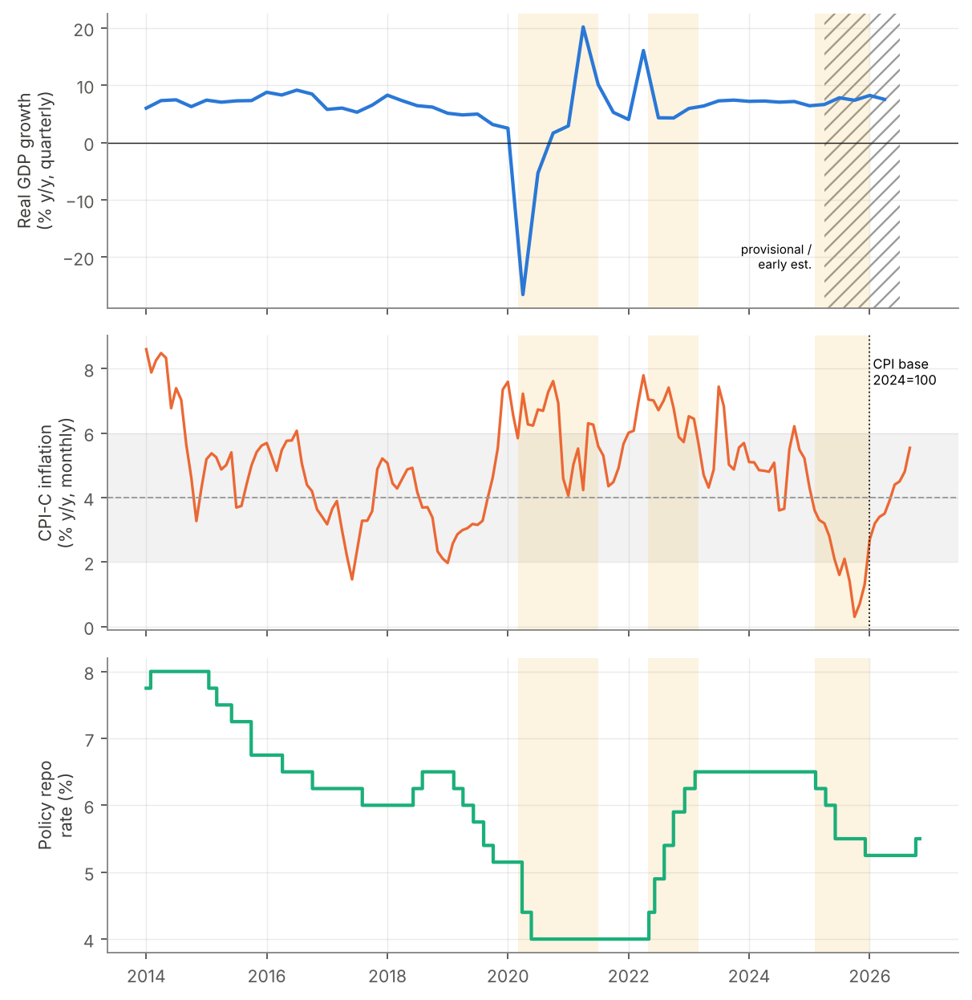
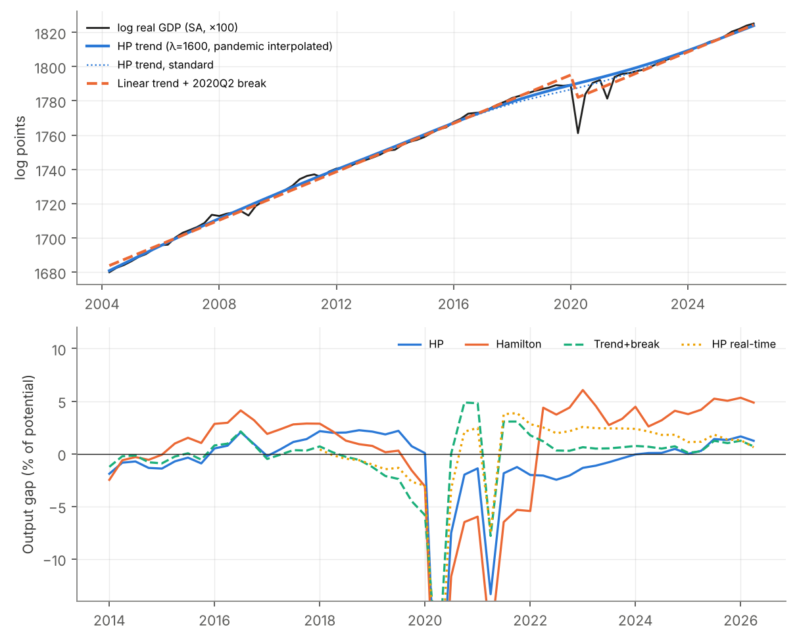
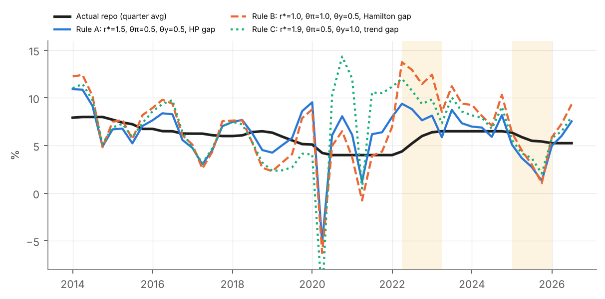
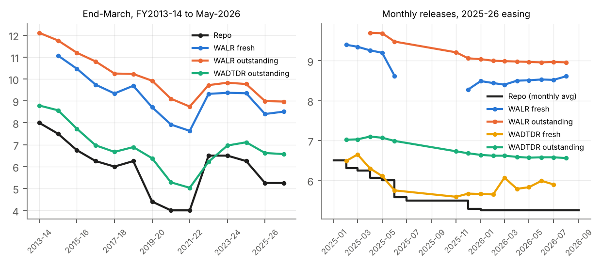
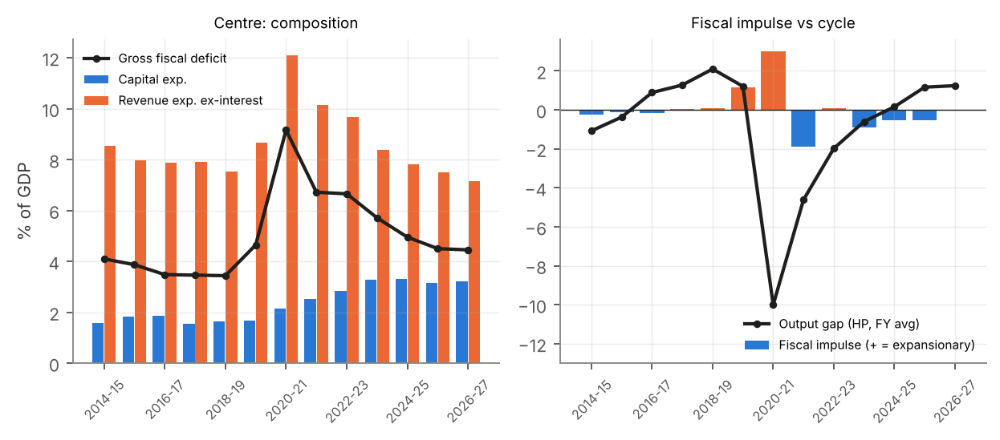

# Monetary and Fiscal Policy in India, 2014–2026: An Empirical Assessment

[](https://github.com/OWNER/india-policy-mix/actions/workflows/ci.yml)


Was the 2025 combination of **monetary easing** and **fiscal consolidation** in India
complementary or offsetting? This project answers that question empirically. It
estimates the output gap several ways, benchmarks the RBI's repo rate against Taylor
rules and an estimated reaction function, measures pass-through to bank lending and
deposit rates, separates cyclical from discretionary changes in the Centre's fiscal
position, and estimates household consumption responses to income and taxes.

The whole analysis, covering 15 tables, 5 figures and every number quoted in the
[report](report/ECO612_report.pdf), is reproduced by one command from official
data stored in the repo. The test suite checks the pipeline against the published
numbers.

> Group project for **ECO612: Applied Macroeconomics** (October 2026), by
> Himanshu Mahale, Sonali Kumari, Rudransh Verma and Srishti Rajora.

---

## Main findings

| | Finding | Evidence |
|---|---|---|
| **Slack** | In 2025 the output gap was close to zero, but it is measured with roughly ±3 pp of uncertainty. Estimates range from −1.8% (unbroken trend) to +0.7% (HP) and +4.6% (Hamilton). Real-time HP put the 2022-23 gap at **+2.3%**; with hindsight it was **−2.0%**. | [Table 2](output/tables/t02_output_gap.md), Fig. 2 |
| **Phillips curve** | Inflation is persistent (ρ = 0.66). Its association with slack is small and *negative* (β₀+β₁ = −0.066, 95% CI [−0.107, −0.025]), which points to supply shocks (food weighs about 46% in CPI) rather than demand. | [Table 3](output/tables/t03_inflation.md) |
| **Policy vs rules** | The 2022-23 tightening was **3.0 pp behind** a Taylor (1993) rule. In 2025 the repo was **2.6 pp above** the rule. The sign of the policy gap survives every one-at-a-time change in calibration. | [Tables 4–5](output/tables/t04_taylor.md), Fig. 3 |
| **Reaction function** | Smoothing is heavy (ρ = 0.92, half-life about 8 quarters). The long-run inflation response is **0.98** (s.e. 0.39), so the Taylor principle is neither confirmed nor rejected. The 2025 cuts were about 20–30 bp *faster* than the RBI's own 2014–26 behaviour predicts. | [Table 6](output/tables/t06_reaction_function.md) |
| **Transmission** | Two-year cumulative pass-through is **0.82** to fresh-loan rates, **0.56** to outstanding loans and **0.85** to deposit rates. Deposits catch up with about a one-year lag. Easing–tightening asymmetry is not statistically detectable (T = 11). | [Tables 7–8](output/tables/t08_distributed_lag.md), Fig. 4 |
| **Credit** | Lending rates and credit growth move *together*. That is the signature of credit-demand shocks, not of a causal transmission effect. | [Table 9](output/tables/t09_credit.md) |
| **Fiscal stance** | The fiscal impulse was **+3.0 pp of GDP** in 2020-21, a pro-cyclical **−1.9 pp** in 2021-22 and **−0.5 pp** in 2025-26. Consolidation came entirely from revenue spending, while capex doubled to about 3.2% of GDP. | [Table 10](output/tables/t10_fiscal.md), Fig. 5 |
| **Spending & growth** | Capex is associated with growth on impact (β = 3.1), but the cumulative association is 0.86 (CI [−1.2, 2.9]). This is consistent with reverse causality, so it is **not** a multiplier. | [Table 11](output/tables/t11_expenditure_growth.md) |
| **Households** | The consumption elasticity to output is 0.73 and the MPC out of GDP is 0.48: moderate smoothing. Tax-to-GDP regressions cannot tell Keynesian from Ricardian behaviour, and the timing of narrative tax cuts is endogenous. | [Tables 12–14](output/tables/t14_tax.md) |

**Verdict.** On aggregate demand, the 2025 instruments *offset* each other: easing
roughly cancelled a fiscal drag of about 0.5% of GDP. On objectives they were
*complementary*. Growth stayed above 7% and the deficit fell to 4.5% of GDP, and a
supply-driven inflation undershoot was not compounded by a demand squeeze. The
conclusion depends most on the size of the output gap: on the Hamilton measure, the
2025 easing was pro-cyclical.

---

## Figures

<p align="center"><br>
<em>Fig. 1. Real GDP growth, CPI-C inflation (2–6% band) and the repo rate. Shaded: pandemic, 2022-23 tightening, 2025 easing.</em></p>

<p align="center"><br>
<em>Fig. 2. Potential output and four output-gap estimates. The methods disagree most after the pandemic.</em></p>

<p align="center"><br>
<em>Fig. 3. Actual repo rate against three Taylor-rule calibrations.</em></p>

<p align="center"><br>
<em>Fig. 4. Repo, lending and deposit rates: annual (left) and monthly through the 2025-26 easing (right).</em></p>

<p align="center"><br>
<em>Fig. 5. Composition of the Centre's spending and the fiscal impulse against the output gap.</em></p>

---

## Methods

| Question | Method | Inference & diagnostics |
|---|---|---|
| Q1 Output gap | HP filter (λ = 1600, pandemic quarters interpolated), Hamilton (2018) regression filter (incl. ex-COVID estimation), linear trend with a 2020Q2 level break; λ, sample-start, end-point and one-sided (real-time) sensitivity | ADF on all gaps |
| Q1 Inflation | π<sub>t</sub> = α + ρπ<sub>t−1</sub> + β₀ỹ<sub>t</sub> + β₁ỹ<sub>t−1</sub> | Newey–West HAC(4), joint F, delta-method long-run effect, Breusch–Godfrey |
| Q2 Taylor rule | i = r\* + π + θ<sub>π</sub>(π − 4) + θ<sub>y</sub>ỹ under 3 calibrations plus one-at-a-time sensitivity | – |
| Q2 Reaction function | i<sub>t</sub> = α + ρi<sub>t−1</sub> + β<sub>π</sub>π<sub>t</sub> + β<sub>y</sub>ỹ<sub>t</sub>, lag variants, dynamic simulation of 2025 | HAC(4), delta-method long-run responses, Wald test of the Taylor principle, Granger tests |
| Q3 Pass-through | Episode ratios over alternative windows; distributed lag ΔR<sub>t</sub> = α + Σβ<sub>j</sub>Δi<sub>t−j</sub> with sign-split asymmetry test; credit lead–lag regression | Cumulative effect with 95% CI, Durbin–Watson, BG |
| Q4 Fiscal | Cyclically adjusted primary balance and fiscal impulse (ε = 0.1, 0.2; HP and Hamilton gaps); growth on comparably scaled Δcapex and Δrevenue spending, with lags | HAC(1), Wald equality tests, cumulative effects |
| Q5 Households | Consumption–income regressions (quarterly elasticity, annual MPC); consumption growth on tax-to-GDP changes and a narrative tax-cut dummy | HAC, BG, ADF |

Each section of the report discusses why these estimates are **associations, not
causal effects**: endogenous policy, supply shocks, reverse causality and
mismeasured slack. It also sets out what identification would be needed instead
(high-frequency policy surprises, narrative shocks, Blanchard–Perotti SVARs,
bank-level exposure).

---

## Reproduce

```bash
git clone https://github.com/OWNER/india-policy-mix.git
cd india-policy-mix
pip install -e ".[test]"        # numpy, pandas, statsmodels, matplotlib, pytest
python -m indiapolicy           # about 3 s: writes output/ and data/processed/
pytest                          # checks results against the published report
```

Or simply `make all`.

## Repository layout

```
├── data/
│   ├── raw/                  # official data, one CSV per source, with source and status columns
│   ├── processed/            # constructed panels (generated)
│   └── DATA_LOG.md           # units, sources, vintages, transformations
├── src/indiapolicy/
│   ├── data.py               # load raw CSVs
│   ├── build.py              # base-year splice, seasonal adjustment, quarterly panel
│   ├── econometrics.py       # OLS/HAC, delta method, diagnostics
│   ├── q1_macro_position.py  # indicators, output gaps, inflation equation
│   ├── q2_monetary_policy.py # Taylor rules, reaction functions
│   ├── q3_transmission.py    # pass-through, distributed lags, credit
│   ├── q4_fiscal_policy.py   # CAPB, fiscal impulse, expenditure–growth
│   ├── q5_households.py      # consumption, taxes, policy-mix summary
│   ├── unit_roots.py         # ADF table
│   └── pipeline.py           # runs everything -> output/
├── output/
│   ├── figures/              # PNG + PDF
│   ├── tables/               # Markdown, LaTeX (booktabs) and CSV
│   └── results.json          # every number cited in the report
├── tests/test_replication.py # 15 checks against the published tables
└── report/ECO612_report.pdf  # the submitted 45-page report
```

## Data

All series come from official sources: the RBI *Handbook of Statistics on the
Indian Economy 2025-26*, RBI press releases and MPC resolutions, MoSPI CPI
releases, Union Budget documents, and IMF IFS quarterly national accounts via FRED.
Values are stored in `data/raw/` with their source and vintage, so the analysis
runs offline. Two practical problems are handled explicitly:

* **GDP base-year break (2011-12 → 2022-23).** The old segment is ratio-spliced
  using 2022-23, which is published under both bases.
* **CPI rebasing (2012 → 2024 = 100) in January 2026.** Published y/y rates are used
  on each base.

Actual, provisional, revised (RE) and budget (BE) figures are flagged throughout. See
[`data/DATA_LOG.md`](data/DATA_LOG.md).

## Limitations and extensions

* **Annual pass-through.** Monthly bank-rate series before 2025 were not accessible,
  so the distributed lags use 11 annual observations. The natural first extension is
  to pull monthly WALR/WADTDR from the RBI's DBIE and set *p* = 12. The estimation
  code needs no changes.
* **Identification.** No regression here identifies a causal policy effect. The
  next step would be high-frequency monetary surprises around MPC announcements and
  narrative or institutional identification of fiscal shocks.
* **Household income.** India publishes no quarterly household disposable income,
  so GDP is used as the income proxy.

## References

Blanchard & Perotti (2002, *QJE*) · Fedelino, Ivanova & Horton (2009, IMF) ·
Hamilton (2018, *REStat*) · Hodrick & Prescott (1997, *JMCB*) · Taylor (1993,
*Carnegie-Rochester*) · RBI (2024), *Updating estimates of the natural rate of
interest for India*, RBI Bulletin. Full list in the [report](report/ECO612_report.pdf).

## Citation

```bibtex
@misc{mahale2026indiapolicy,
  author = {Mahale, Himanshu and Kumari, Sonali and Verma, Rudransh and Rajora, Srishti},
  title  = {Monetary and Fiscal Policy in India, 2014--2026: An Empirical Assessment},
  year   = {2026},
  note   = {ECO612 Applied Macroeconomics group project},
  howpublished = {\url{https://github.com/OWNER/india-policy-mix}}
}
```
